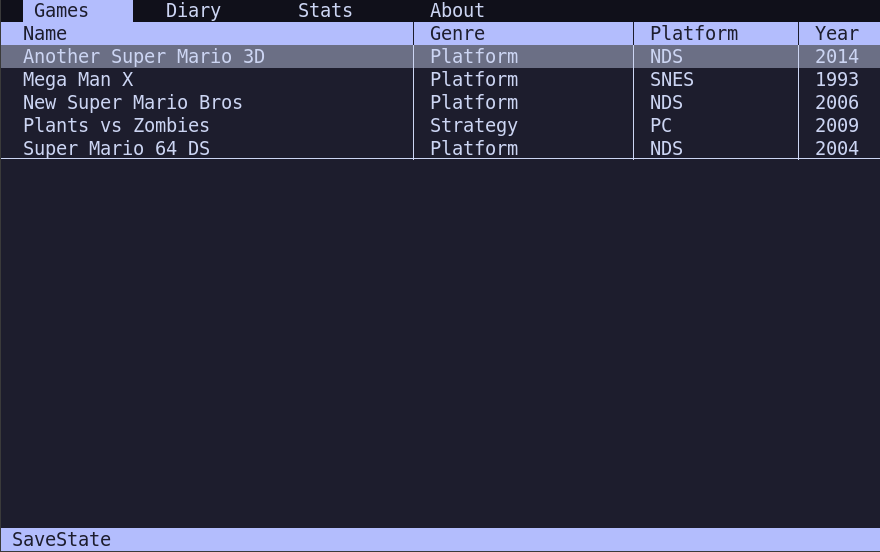
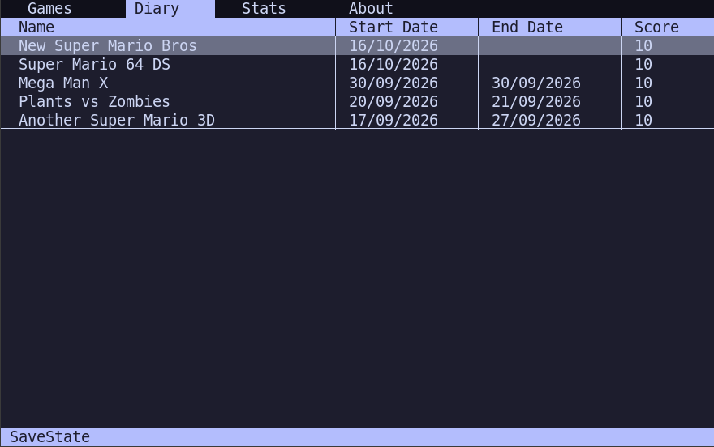
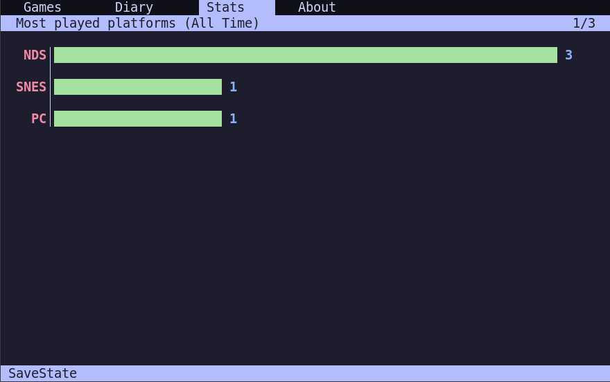

# SaveState

**SaveState** is a TUI program that lets you catalog games you have played and
add diary entries for them. It also lets you view statistics, like most-played
genres, platforms or decades.

**SaveState** is **free software** and it is distributed under **GNU GPL v3 or
later**.





## Building

**SaveState** depends on C standard library, ncurses, sqlite3 and **inih**
(which is included as a submodule). To build it, you can use cmake:

```
$ cmake -B build -DCMAKE_BUILD_TYPE=Release
$ cmake --build build
```

## Usage

This program uses Vi keybindings. When you start it, you can use the following
commands:

- **J, K, gt, gT, tab, shift+tab**: Navigate between tabs.
- **a**: Add a new game (when you are in the **Games** tab).
- **i**: Insert a new log for that game (when you are in the games tab).
- **c**: Change a game entry or a log entry.
- **f**: Filter a game or log by name. You can also use it on the **Stats** tab
  to filter by year.
- **h, j, k, l**: general navigation.

The program has three main tabs: **Games**, **Diary** and **Stats**. On the
**Games** tab, you can view, filter and add games or update game data and
insert logs. On the **Diary** tab, you can filter logs or update log data.

When adding a diary entry, the date **must** be in the format `dd/mm/yyyy`.

On the **Stats** tab, you can view statistics about the games you have played.
If you press f, you can view statistics for a specific year.

## Configuration

The program data and configuration is stored in `~/.savestate`. You can
configure the program through the file config.ini on the configuration
directory. You can configure the following parameters:

- **colorscheme**: The colorscheme can be `catppuccin`, `default` or
  `basic-color`.

Example configuration file:

```
[SaveState]
colorscheme = catppuccin
```
